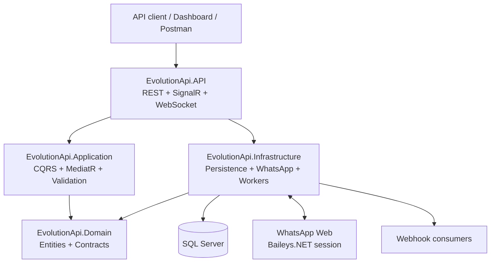
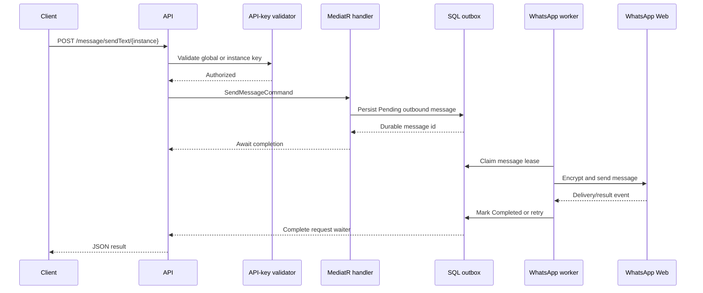
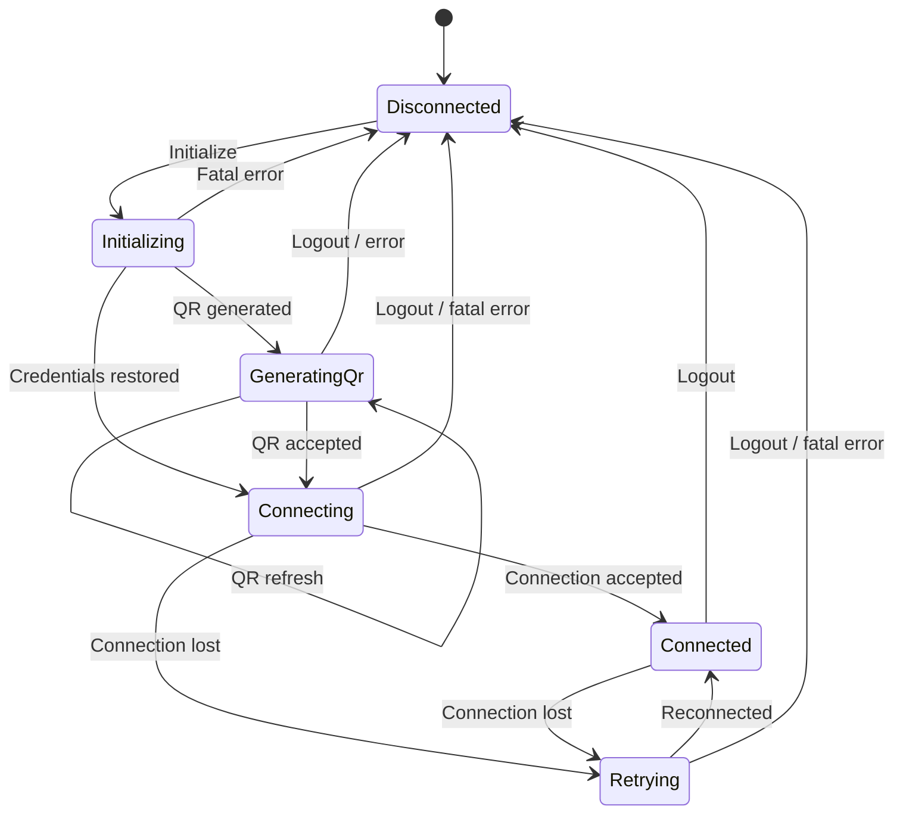
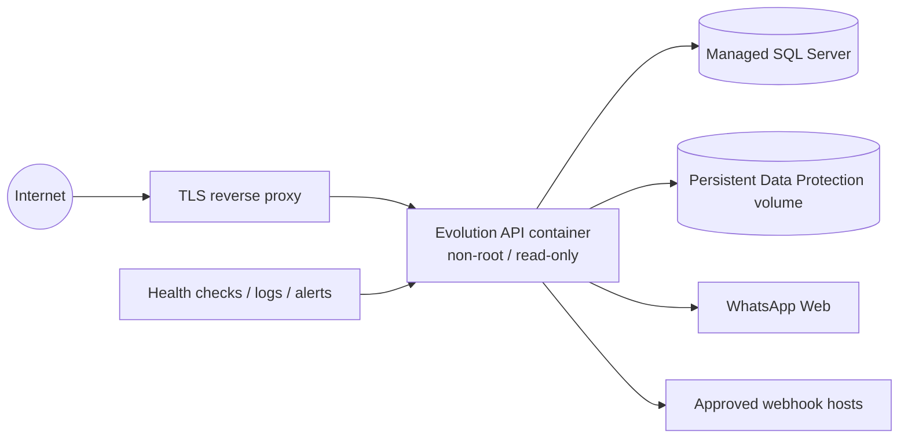
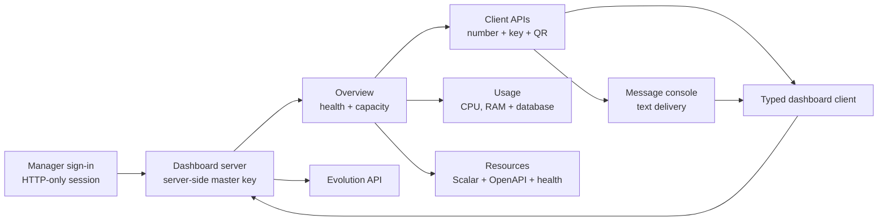
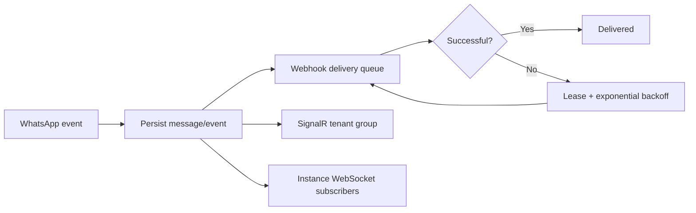

# Evolution API .NET


A .NET 10 WhatsApp Web gateway built with Clean Architecture, CQRS/MediatR, Entity Framework Core, SignalR, WebSockets, and Baileys.NET.

It provides an Evolution API-style REST interface for managing WhatsApp Web sessions, sending messages, receiving events, delivering webhooks, and integrating with OpenAI, Typebot, Chatwoot, RabbitMQ, Amazon SQS, and NATS.

> This project uses a WhatsApp Web client connection. Use dedicated test numbers, follow applicable WhatsApp policies, and validate account and operational risk before production use.

## Contents

- [Architecture](#architecture)
- [Capabilities](#capabilities)
- [Repository layout](#repository-layout)
- [Requirements](#requirements)
- [Run locally](#run-locally)
- [Configuration](#configuration)
- [API quick start](#api-quick-start)
- [Events and webhooks](#events-and-webhooks)
- [Testing](#testing)
- [Production deployment](#production-deployment)
- [Security model](#security-model)
- [Operations checklist](#operations-checklist)
- [Known limitations](#known-limitations)

## Architecture



### Runtime request flow



### WhatsApp instance lifecycle



### Production topology



## Capabilities

| Area | Included capabilities |
|---|---|
| Instances | Create, connect, QR retrieval, reconnect, state, logout, delete |
| Messaging | Text, media, audio, sticker, location, contact, reaction, poll, list, status |
| Data | Chats, contacts, messages, groups, labels, profile operations |
| Events | Webhooks, SignalR tenant events, instance WebSockets |
| Reliability | SQL-backed outbox, leases, retries, exponential backoff, scheduled jobs |
| Security | API keys, tenant resolution, rate limits, encrypted session keys, SSRF protection |
| Integrations | OpenAI, Typebot, Chatwoot, RabbitMQ, Amazon SQS, NATS |
| Dashboard | MudBlazor WebAssembly UI for instances, QR pairing, messages, resources, and API settings |

## Repository layout

```text
EvolutionAPI/
├── src/
│   ├── EvolutionApi.Domain/          Entities, enums, exceptions, interfaces
│   ├── EvolutionApi.Application/     CQRS handlers, validation, DTOs, mappings
│   ├── EvolutionApi.Infrastructure/  EF Core, Baileys engine, queues, webhooks
│   ├── EvolutionApi.API/             REST, middleware, hubs, WebSockets, OpenAPI
│   ├── EvolutionApi.Dashboard/       Blazor WebAssembly manager UI
│   └── EvolutionApi.Dashboard.Server/ secure dashboard host and API proxy
├── tests/
│   └── EvolutionApi.Tests/           xUnit unit-test layer
├── Dockerfile
├── docker-compose.production.template.yml
├── .env.production.template
├── EvolutionApi.DotNet.slnx
└── EvolutionApi.DotNet.sln
```

The dashboard and tests are separate layers. Production projects never depend on the test project.

## Requirements

- .NET 10 SDK
- SQL Server, Azure SQL, or SQL Server in Docker
- A public HTTPS URL for production webhooks and callbacks
- A dedicated WhatsApp test number for staging validation
- Docker Engine and Compose for container deployment

## Run locally

Restore, migrate, and run:

```powershell
dotnet restore EvolutionApi.DotNet.slnx
dotnet ef database update `
  --project src/EvolutionApi.Infrastructure `
  --startup-project src/EvolutionApi.API
dotnet run --project src/EvolutionApi.API
dotnet run --project src/EvolutionApi.Dashboard.Server
```

The API also creates the configured database and applies pending EF migrations at
startup, before initializing Hangfire storage or starting background workers. The
SQL login must have permission to create the database (when missing) and update
its schema. Hangfire then creates its own tables in the same database.

After changing the EF model, generate a migration before updating the database:

```powershell
dotnet ef migrations add <MigrationName> `
  --project src/EvolutionApi.Infrastructure `
  --startup-project src/EvolutionApi.API
```

Development endpoints:

| Endpoint | URL |
|---|---|
| Scalar | `http://localhost:5051/scalar/v1` |
| OpenAPI | `http://localhost:5051/openapi/v1.json` |
| Liveness | `http://localhost:5051/health/live` |
| Readiness | `http://localhost:5051/health/ready` |
| SignalR | `http://localhost:5051/hubs/events` |
| WebSocket | `ws://localhost:5051/ws/{instanceName}` |
| Dashboard | `http://localhost:5160` |

The manager dashboard runs through `EvolutionApi.Dashboard.Server`. It owns the global API key server-side and uses an HTTP-only manager session cookie in the browser. Copy `src/EvolutionApi.Dashboard.Server/appsettings.template.json` to the ignored `appsettings.Development.json`, then set a local manager password and the same API master key used by the gateway.

### Dashboard modules



The manager enters only a WhatsApp number. The dashboard generates a random instance API key, provisions the client, and displays its QR code. The client receives only their generated instance key. The master API key stays on the dashboard server and is never placed in browser storage, URLs, or client responses.

The Usage page reports API-process CPU and RAM, total SQL Server allocated space, and per-client estimated stored database payload. CPU and RAM cannot be accurately attributed to individual WhatsApp numbers while all clients share one API process. Use isolated workers or containers per client if hard per-client CPU/RAM allocation is required.

## Configuration

Use environment variables or a secret manager for credentials. Do not commit production secrets.

```text
ConnectionStrings__DefaultConnection=Server=...;Database=EvolutionApi;...
Evolution__ApiKey=<global-api-key>
Evolution__HangfireDashboardApiKey=<different-dashboard-key>
Dashboard__ManagerPassword=<manager-dashboard-password>
Evolution__ServerUrl=https://api.example.com
DataProtection__KeyPath=/var/lib/evolution-api/data-protection-keys
Media__MaxDownloadBytes=33554432
OutboundHttp__AllowedHosts=hooks.example.com,cdn.example.com
ApiDocumentation__Enabled=false
```

Production startup fails fast unless the SQL connection, gateway key, Hangfire dashboard key, and persistent Data Protection key path are configured. Preserve the Data Protection directory across restarts or encrypted session credentials cannot be decrypted.

## API quick start

### 1. Create an instance

```powershell
curl -X POST http://localhost:5051/instance/create `
  -H "apikey: <global-api-key>" `
  -H "Content-Type: application/json" `
  -d '{"instanceName":"my-clinic","token":"clinic-secret-token"}'
```

### 2. Request the QR code

```powershell
curl http://localhost:5051/instance/connect/my-clinic `
  -H "apikey: clinic-secret-token"
```

Scan the returned QR code with the WhatsApp account on the dedicated phone. The session credentials are persisted encrypted in SQL Server.

### 3. Send a text message

```powershell
curl -X POST http://localhost:5051/message/sendText/my-clinic `
  -H "apikey: clinic-secret-token" `
  -H "Content-Type: application/json" `
  -d '{"number":"1234567890","text":{"message":"Hello from Evolution API .NET"}}'
```

All protected HTTP endpoints require `apikey`. Instance routes accept the instance key; global management operations require the global key. SignalR requires the global key. WebSocket clients must provide the key in the `apikey` header; never put credentials in URLs.

## Events and webhooks



Webhook deliveries are durable. A process restart loses only in-memory wake-up hints; pending SQL rows remain recoverable by the worker. Configure public webhook destinations and use `OutboundHttp__AllowedHosts` to restrict them further.

## Testing

The test project is a dedicated solution layer and is included in both `.slnx` and `.sln`.

```powershell
dotnet restore EvolutionApi.DotNet.slnx
dotnet build EvolutionApi.DotNet.slnx -c Release
dotnet test EvolutionApi.DotNet.slnx -c Release
```

The current unit suite covers:

- Result and pagination behavior
- Production configuration validation
- Global and instance API-key authorization
- Public URL and SSRF rules
- Data Protection encryption/decryption round trips

Staging tests must additionally exercise QR pairing, restart recovery, reconnects, inbound/outbound messages, media, webhooks, tenant isolation, and database restore.

## Production deployment

Copy `.env.production.template` to `.env.production`, fill it from a secret manager, apply migrations, and deploy behind a TLS reverse proxy:

```powershell
dotnet ef database update `
  --project src/EvolutionApi.Infrastructure `
  --startup-project src/EvolutionApi.API `
  --configuration Release

docker compose -f docker-compose.production.template.yml up -d --build
```

The container runs as a non-root user, binds the application to localhost, uses a read-only filesystem, and persists Data Protection keys in a named volume. Expose only the reverse proxy publicly. Apply host-level egress controls in addition to the application URL validator.

## Security model

1. API keys are validated before protected HTTP actions execute.
2. WebSocket upgrades validate the key before accepting the connection.
3. SignalR connections require the global gateway key.
4. Hangfire is deny-by-default and requires a separate dashboard key.
5. Health probes are anonymous; API documentation is disabled in production by default.
6. Media and webhook URLs must be public HTTP(S) destinations and can be restricted by host allow-list.
7. Session credentials and Signal keys are encrypted at rest through Data Protection.
8. API keys, message payloads, phone numbers, and session material must be redacted from logs and infrastructure telemetry.

## Operations checklist

- Use managed SQL Server with backups and tested restore procedures.
- Keep API keys, database credentials, and Data Protection keys in a secret manager.
- Preserve the Data Protection volume on every redeploy.
- Protect `/hangfire` with the dedicated dashboard key and restrict network access.
- Keep Scalar/OpenAPI disabled in production unless explicitly required.
- Configure HTTPS and trusted forwarded headers at the reverse proxy.
- Monitor connection state, QR failures, queue depth, webhook failures, retries, and database readiness.
- Run the staging WhatsApp smoke test before promoting a release.
- Deploy one active connector per WhatsApp instance unless distributed ownership is implemented.

## Known limitations

- The WhatsApp Web connector depends on upstream WhatsApp Web protocol behavior and Baileys.NET compatibility.
- A WhatsApp session requires durable SQL data and a durable Data Protection key directory.
- Multi-replica deployment requires distributed instance ownership and shared coordination; deploy a single API replica until that is configured.
- Docker image builds require Docker Engine; the source repository itself requires only the .NET SDK for local compilation.

## License

Apache License 2.0. Review upstream and dependency licenses before redistribution.
